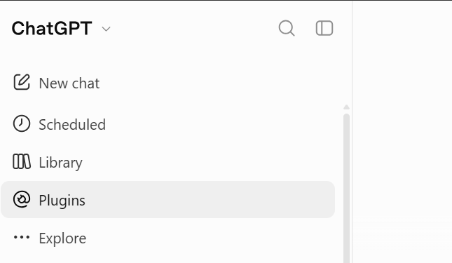
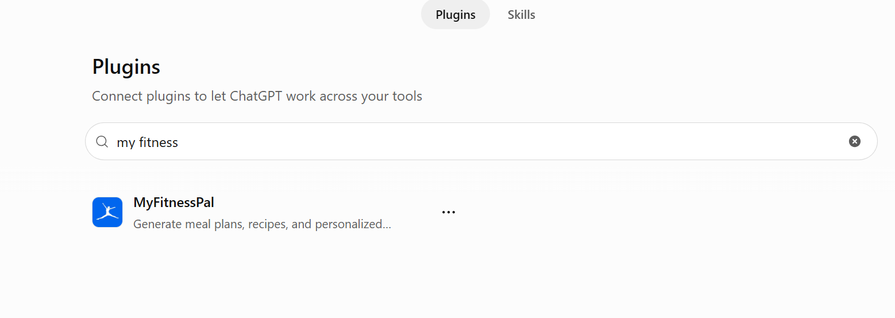
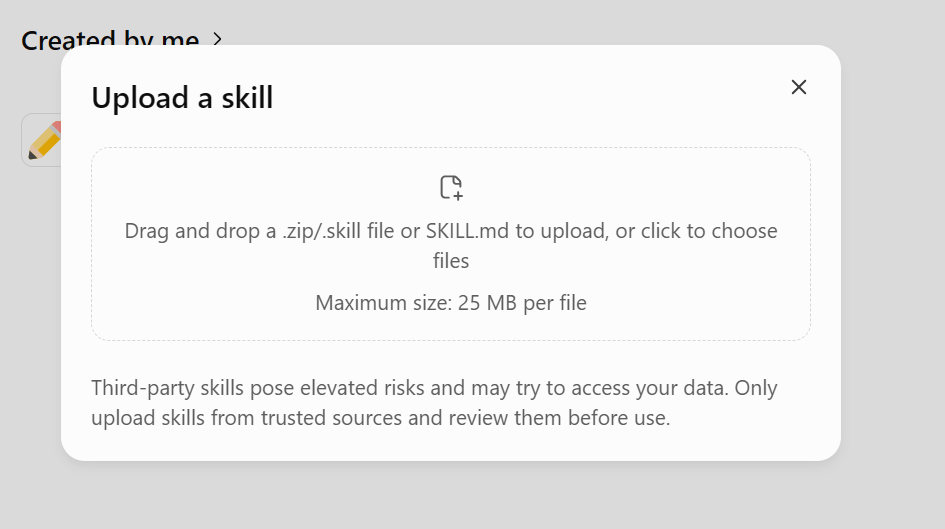

# Youssef Fathy Skills

Free, ready-to-use AI skills for ChatGPT and Claude. Download the ZIP, upload it, and start using it.

| Skill | Made for | What it does | Download |
| --- | --- | --- | --- |
| [Verified Diet Planner](chatgpt/verified-diet-planner) | ChatGPT | Builds a personalized meal plan in Arabic or English, with calories and macros checked against MyFitnessPal and USDA data | [ZIP](https://github.com/YoussefFathy88/Youssef-Fathy-Skills/raw/main/downloads/verified-diet-planner.zip) |
| [Presentation Builder](claude/presentation-builder) | Claude | Guides you from design system and outline to a finished slide deck, using only your own content | [ZIP](https://github.com/YoussefFathy88/Youssef-Fathy-Skills/raw/main/downloads/presentation-builder.zip) |
| [CapCut Claude Montage](claude/capcut-claude-montage) | Claude Code (Windows) | Adds word-by-word captions and your own images and videos into a copy of your CapCut desktop project, so you can still edit by hand and export | [ZIP](https://github.com/YoussefFathy88/Youssef-Fathy-Skills/raw/main/downloads/capcut-claude-montage.zip) |
| [Real Logos](claude/real-logos) | Claude | Uses only official brand logos in your videos and designs, and saves each one to a local library so it's downloaded once and reused forever | [ZIP](https://github.com/YoussefFathy88/Youssef-Fathy-Skills/raw/main/downloads/real-logos.zip) |

Only upload skills from sources you trust, and feel free to read the files in this repo first.

## Verified Diet Planner

**You need:** ChatGPT Plus (the free tier doesn't support skills) and the MyFitnessPal plugin.

**1. Open Plugins in ChatGPT.**

**2. Search for MyFitnessPal and connect it.**

**3. Download the [skill ZIP](https://github.com/YoussefFathy88/Youssef-Fathy-Skills/raw/main/downloads/verified-diet-planner.zip), then go to Skills, choose Add Skill, and upload it.**

**4. Ask ChatGPT for a diet plan.** It starts by asking about you and your goal.

The skill is for adults. It pauses for anyone under 18, pregnancy or breastfeeding, medical conditions, or a history of disordered eating until a clinician has cleared the plan. It doesn't replace medical advice.

Use it as a baseline. If you want to improve it, just ask ChatGPT to update the skill.

**Using Claude or Gemini?** You can try uploading it there too, but ask them to make it compliant with their platform first.

## Presentation Builder

**You need:** Claude.

1. Download the [skill ZIP](https://github.com/YoussefFathy88/Youssef-Fathy-Skills/raw/main/downloads/presentation-builder.zip).
2. Upload it in Claude.
3. Ask Claude to build a presentation. It asks about your brand, goal, and audience, then asks for your content and shows you an outline for approval before building any slides.

## Real Logos

**You need:** Claude Code or Claude desktop (it saves files on your computer), and Python.

1. Download the [skill ZIP](https://github.com/YoussefFathy88/Youssef-Fathy-Skills/raw/main/downloads/real-logos.zip).
2. Upload it in Claude.
3. Whenever your video, thumbnail or slide names a product, Claude checks your logo library first. If the logo isn't there yet, it finds the official file from the brand's own site, checks it, and saves it to `~/.real-logos`. The next project reuses it with no download.

It never draws, generates or imitates a logo. If a brand has no official file, Claude tells you and uses the name as text instead.

## CapCut Claude Montage

**You need:** Windows, CapCut desktop, Claude Code (Claude Pro or Max), Python and ffmpeg. Mac is not supported.

1. Download the [skill ZIP](https://github.com/YoussefFathy88/Youssef-Fathy-Skills/raw/main/downloads/capcut-claude-montage.zip).
2. Unzip it into `C:\Users\<you>\.claude\skills\` so you get `capcut-claude-montage\SKILL.md` there.
3. Close your project in CapCut and tell Claude Code **"montage on CapCut"**. It checks your setup first, asks about your caption style once, then adds the captions (and any images or videos you give it) into a copy called `<project> Edit`. Open that copy in CapCut, adjust, and export.

Transcription is free with Whisper on your PC. The skill also offers ElevenLabs for faster, more accurate captions (needs an ElevenLabs account). Your original project is never changed, and every change can be undone. Details in the [skill's README](claude/capcut-claude-montage).
